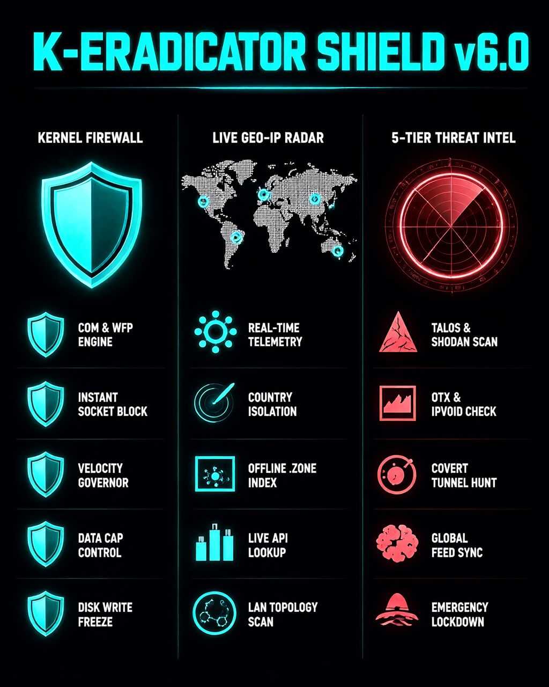

# 🛡️ K-ERADICATOR SHIELD v6.0
### Sovereign Kernel-Level Firewall, Real-Time Socket Telemetry & 5-Tier Cyber Threat Intelligence Suite for Windows 11

 

### ⬇️ [DOWNLOAD K-ERADICATOR SHIELD SETUP (.EXE) — التحميل المباشر للبرنامج](https://github.com)

 

---

## 🔥 Executive Summary | نبذة معمارية عن المنظومة

**K-Eradicator Shield** is an enterprise-grade, sovereign desktop cybersecurity and network defense suite engineered specifically for **Windows 11**. Unlike traditional passive firewalls that rely on slow command-line wrappers (`netsh`), K-Eradicator Shield communicates directly with the **Windows Kernel & COM (`HNetCfg.FwPolicy2` + `iphlpapi`)** to inspect live sockets, trace geographic destinations in real time, hunt covert reverse shells, and enforce sub-millisecond threat blackholing with a **60 FPS zero-lag interface**.

**منظومة K-Eradicator Shield** هي درع حماية سيبراني متكامل وجدار ناري ذكي يعمل على مستوى نواة نظام **Windows 11**. على عكس الجدران النارية التقليدية البطيئة، تتواصل المنظومة مباشرة مع واجهات النواة (`COM / WFP / iphlpapi`) لمراقبة كل حزمة بيانات، تتبع الوجهات الجغرافية حياً على الخريطة، صيد الأنفاق الخفية والعمليات الشبحية، وتنفيذ الحظر الفوري في أقل من مللي ثانية مع واجهة رسومية فائقة السلاسة لا تتجمد أبداً.

---

## 🖥️ Complete Module-by-Module Breakdown | التشريح التفصيلي لجميع واجهات المنظومة

### 1️⃣ Network Overview & Active Connections (`الواجهة الرئيسية والخريطة الحية`)
* **Live Throughput Telemetry:** Dual-channel real-time download/upload speed graphs (`KB/s` & `MB/s`) with peak surge detection.
* **Interactive Live Geo-IP Radar Map:** Vector world map plotting active outbound connections with animated radar pulses, bidirectional anti-collision process labels, and hover telemetry cards.
* **Dual Geo-Resolution Engine:** Instant **Zero-Latency Offline `.zone` Index** paired with an optional **Live API Lookup** toggle for deep city/ISP precision.
* **One-Click Process Kill & Firewall Block:** Instantly sever active TCP/UDP sockets via `SetTcpEntry` (`MIB_TCP_STATE_DELETE_TCB`) and lock down executables in Windows Firewall.
* **Per-Process Constraint Engine:** Throttle bandwidth velocity, enforce strict data caps, freeze disk writes, and run async Geo-IP destination traces per app.

### 2️⃣ Threat Interceptor & Geographic Isolation (`صائد التهديدات وعزل الدول`)
* **Sovereign Country Isolation (`ENFORCE ABSOLUTE BAN`):** Automatically aggregate and block thousands of CIDR IP blocks for any target country at the Windows Firewall level in seconds.
* **Domain & IP Blackholing:** Instant multi-IP DNS resolution and simultaneous inbound/outbound rule enforcement.
* **Global Threat Feed Sync:** Automated TLS-verified (`ssl.CERT_REQUIRED`) synchronization with global threat feeds to block botnets and C2 servers.
* **Covert Tunnel & Ghost Process Hunter:** Heuristic background scanner that detects hidden reverse shells and unverified background listeners.

### 3️⃣ 5-Tier Cyber Threat Intel Radar (`رادار الاستخبارات السيبرانية الخماسي`)
* **5-Engine Parallel Intelligence Lookup:** Query any suspicious **IP, Domain, URL, or File Hash** simultaneously across **Cisco Talos, Shodan, AlienVault OTX, IPVoid, and Hybrid Analysis**.
* **Emergency Blackhole Trigger (`BLACKHOLE TARGET`):** Immediately isolate confirmed malicious targets from the Windows kernel.

### 4️⃣ Local LAN Topology Scanner & Deep Data Analytics (`ماسح الشبكة والتحليلات العميقة`)
* **ARP & Active Subnet Discovery:** Sweeps your local Wi-Fi/Ethernet network to uncover connected devices, MAC vendors, and open ports.
* **SQLite WAL Historical Forensics & Global Lockdown:** Tracks historical app bandwidth and provides a one-click **`ACTIVATE LOCKDOWN`** panic switch for instant network isolation.

---

## 🚀 Installation & Usage | التثبيت والتشغيل

1. Go to the **[Official Releases Page](https://github.com/7eyksi/K-Eradicator-Shield)** and download **`K_Eradicator_Shield_Suite_Setup.exe`**.
2. Run the installer and allow **Administrator (UAC)** privileges (mandatory for Windows Kernel Firewall & Socket control).
3. Launch **K-Eradicator Shield** and experience sovereign network defense.
